# CI Map

GitHub Actions · `ubuntu-latest` · Node 24 via `.nvmrc` · required check: `ci-ok`
Free on this repo (public = unlimited minutes, CodeQL, Dependabot).

---

## System

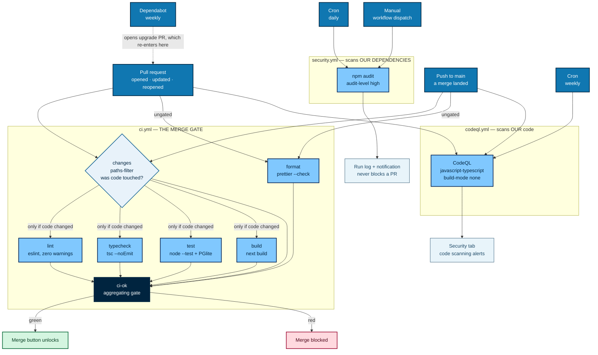

Only `ci.yml` blocks merges. CodeQL reports to the Security tab, `npm audit` to its run log.

---

## Coverage

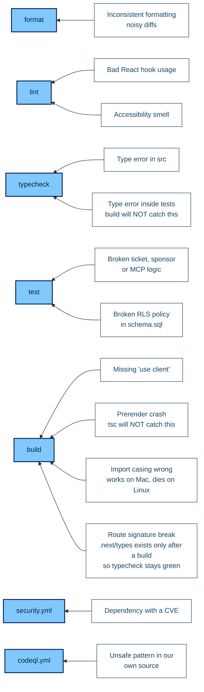

The two "will NOT catch this" labels are why `typecheck` and `build` both exist.

---

## Job anatomy

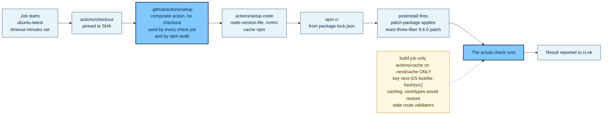

`npm ci` always reinstalls `node_modules`. The npm cache only skips the download.

---

## The ci-ok gate

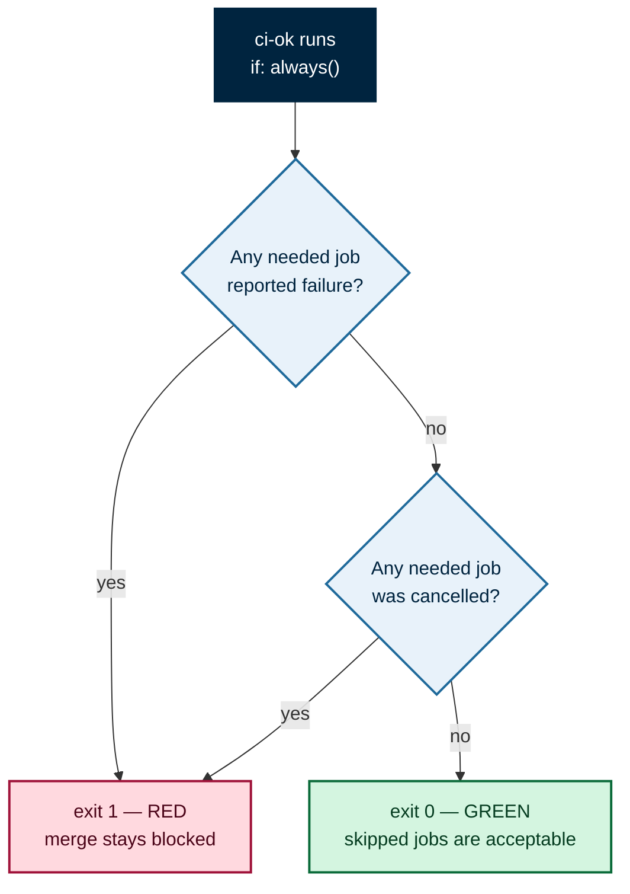

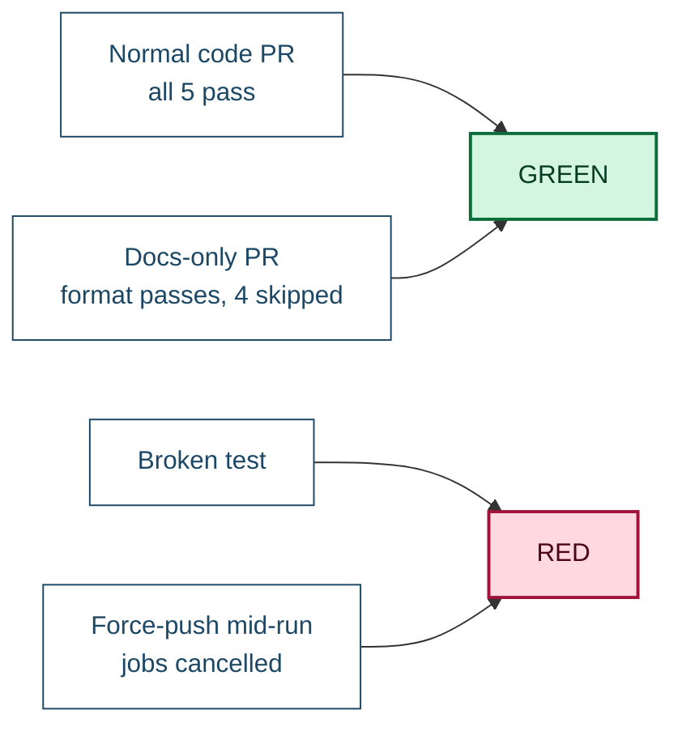

Branch protection requires named checks. Require `build` directly and a docs-only PR
that skips it waits forever. `ci-ok` is the only check marked required, so adding a
sixth check later means editing its `needs` list, not GitHub settings.

---

## Path filter

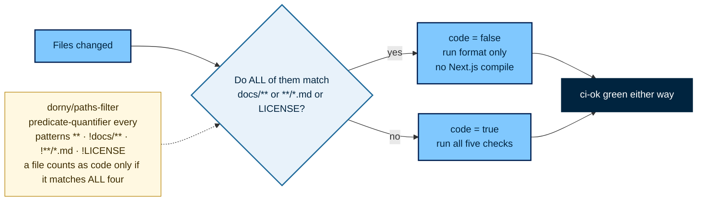

`format` stays ungated because Prettier covers Markdown.

---

## Security

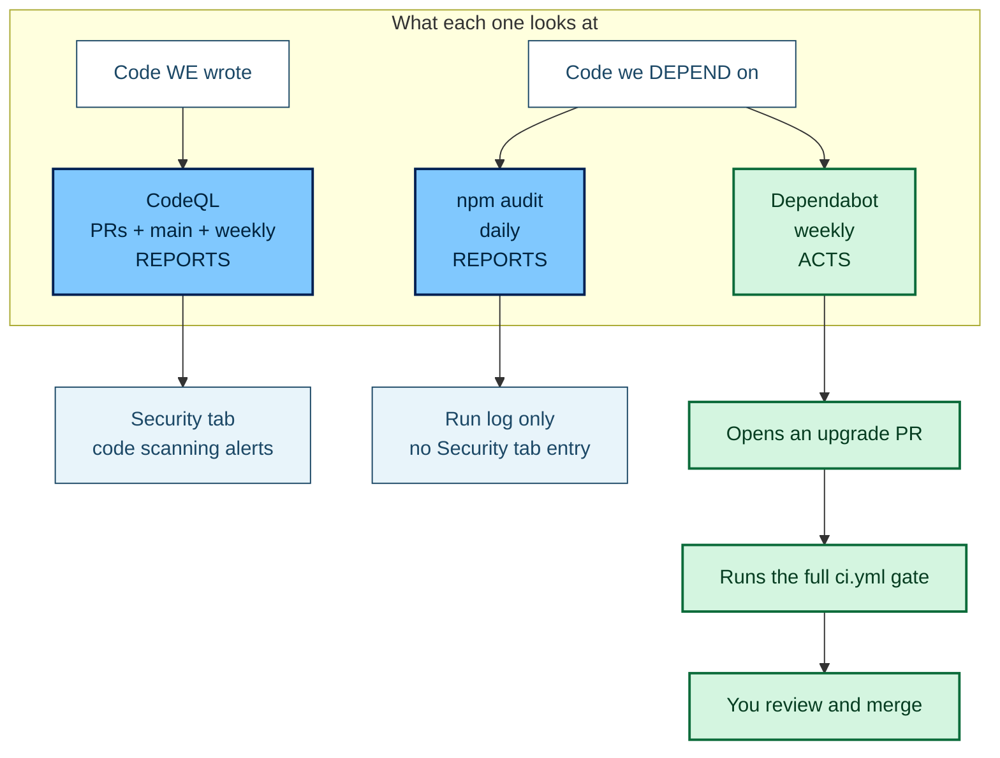

CodeQL is the only one that reads our source. Dependabot is the only one that acts.

`npm audit` runs on a cron, not as a PR gate: an advisory on a transitive package with
no fix available would block every unrelated PR until upstream patches it.

There is no nightly re-run of lint/test/build. `npm ci` installs from a committed
lockfile, so an unchanged `main` produces identical results. Only the CVE database and
CodeQL's queries change on their own, and the two scheduled scans cover those.

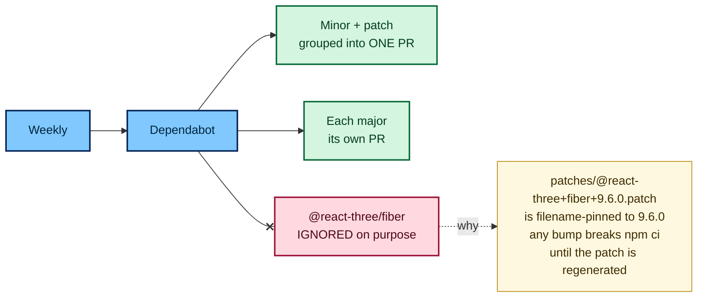

---

## Workflow hygiene

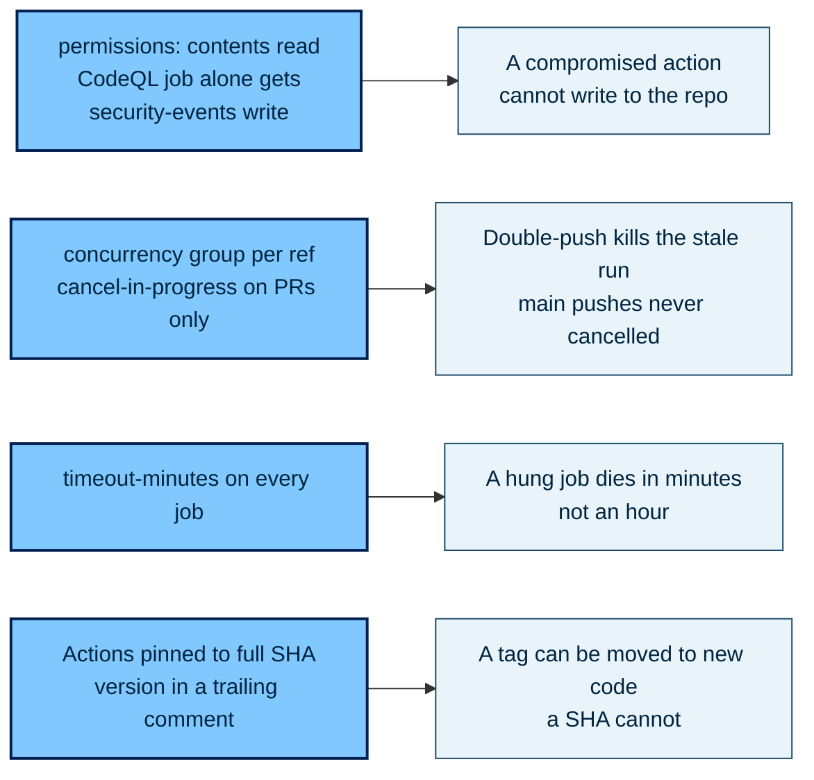

Dependabot's `github-actions` ecosystem keeps those SHA pins current.

---

## When it goes red

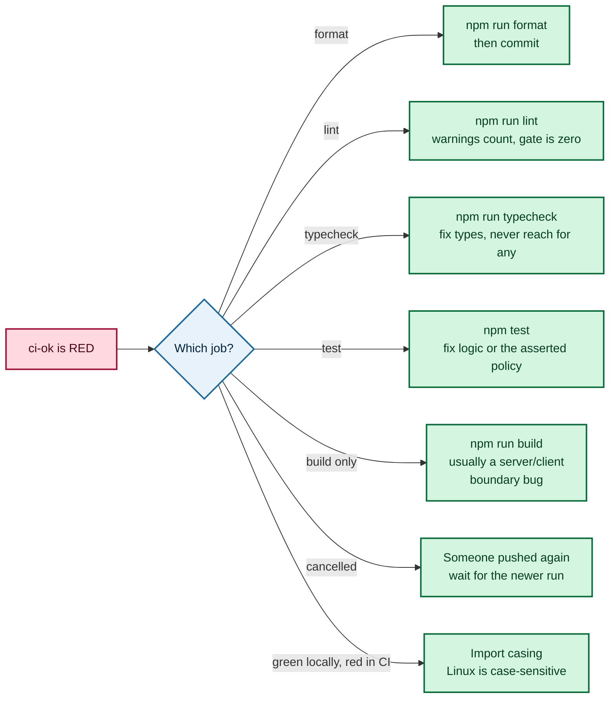

---

## Commands

```bash
npm run format:check   # the format job
npm run lint           # the lint job
npm run typecheck      # the typecheck job
npm test               # the test job
npm run build          # the build job
```

`--max-warnings=0` lives in `package.json`, not in CI, so local and CI strictness can't
drift. Tests need no secrets: PGlite runs Postgres in-process and loads
`supabase/schema.sql` plus the migrations to exercise real RLS policies.

---

## One-time local config

```bash
git config blame.ignoreRevsFile .git-blame-ignore-revs
```

`format` stays red until one repo-wide `npm run format` commit lands. `.git-blame-ignore-revs`
holds comments only until then — add that commit's SHA to it so `git blame` skips it.

---

## Ubuntu only

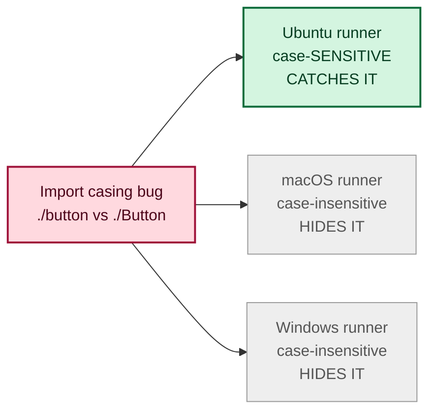

Production is Linux, so Linux is what CI tests. `.nvmrc` plus the lockfile keeps
developer machines consistent, which is what a Node matrix would otherwise be for.

---

## Branch protection

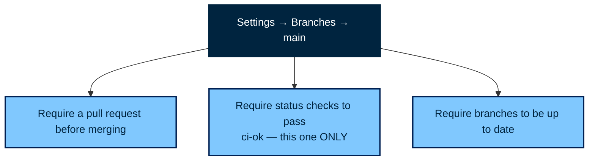

Repo settings, not files. Someone has to click these.

---

## Deployment

Not set up. See [`CD_job.md`](./CD_job.md).
