# CI Map

GitHub Actions · `ubuntu-latest` · Node 24 via `.nvmrc`
Required checks: `format` · `lint` · `typecheck` · `test` · `build`
Free on this repo (public = unlimited minutes, CodeQL, Dependabot).

---

## System

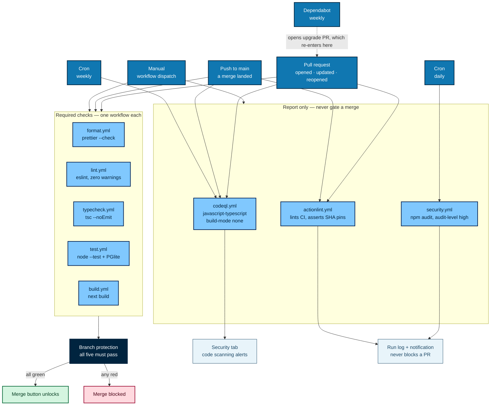

One check per workflow, so each reports its own status. CodeQL reports to the Security
tab, `npm audit` to its run log.

---

## Coverage

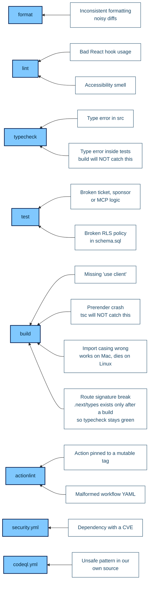

The two "will NOT catch this" labels are why `typecheck` and `build` both exist.

---

## Job anatomy

Every check workflow is one job with the same shape.

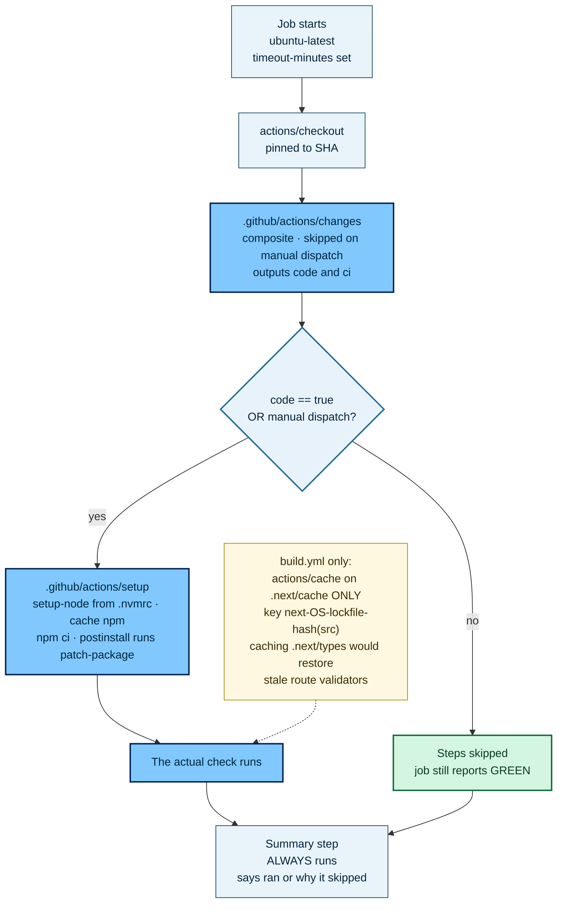

`npm ci` always reinstalls `node_modules`. The npm cache only skips the download.
`format.yml` has no change detection: Prettier covers Markdown, so it always runs.

---

## Required checks

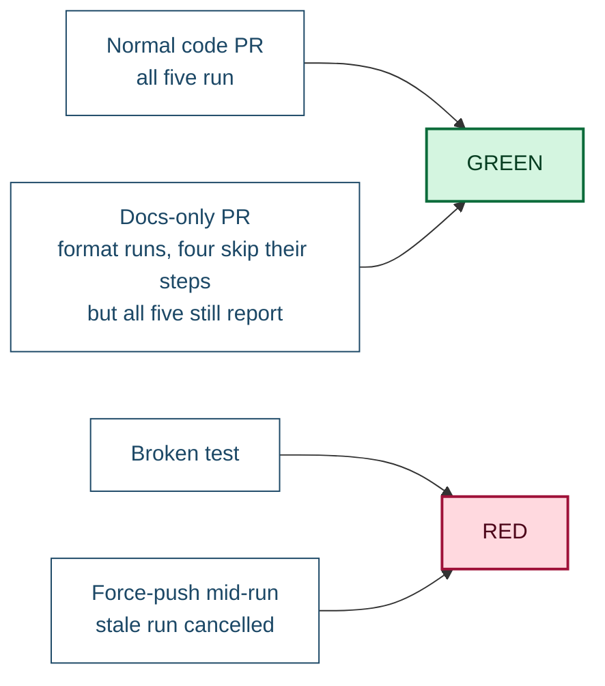

A required check that never reports leaves a PR pending forever. That is why no
workflow uses a top-level `paths:` filter and no job is skipped wholesale: the job
always runs and skips its steps instead.

---

## Path filter

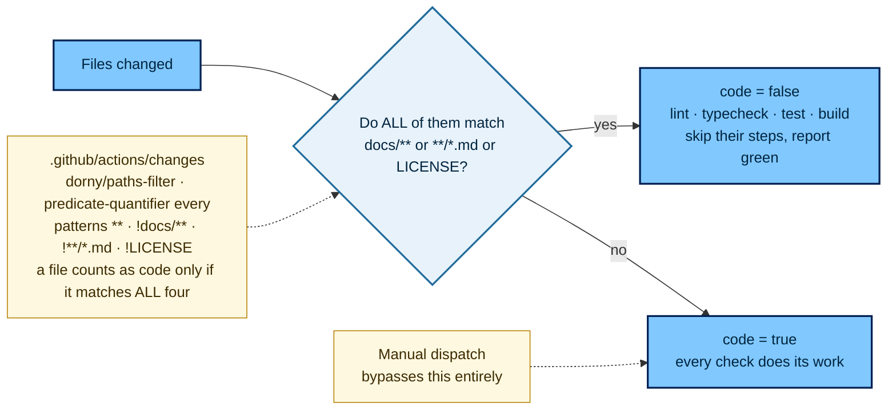

One composite action defines the rule, so the patterns live in a single file.
`actionlint` uses the same action's `ci` output, scoped to `.github/**`.

---

## Security

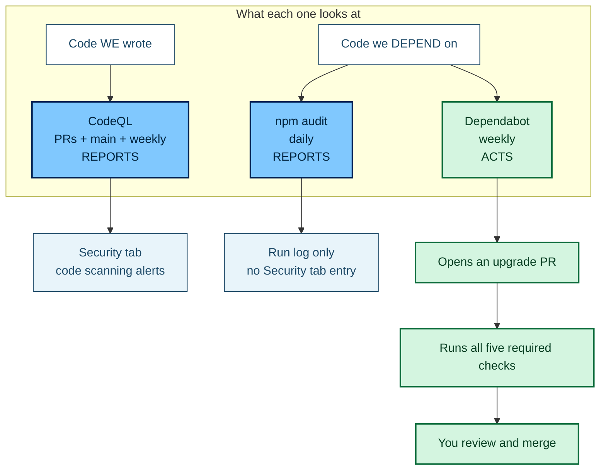

CodeQL is the only one that reads our source. Dependabot is the only one that acts.

`npm audit` runs on a cron, not as a PR gate: an advisory on a transitive package with
no fix available would block every unrelated PR until upstream patches it.

There is no nightly re-run of lint/test/build. `npm ci` installs from a committed
lockfile, so an unchanged `main` produces identical results. Only the CVE database and
CodeQL's queries change on their own, and the two scheduled scans cover those.

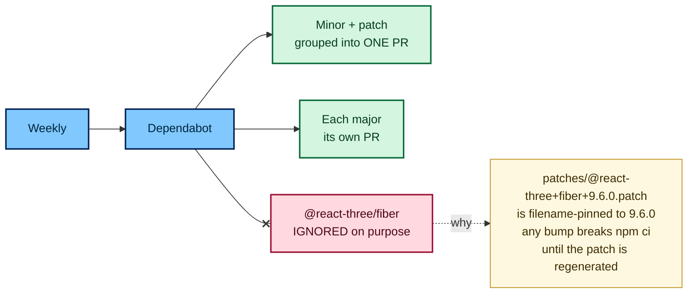

---

## Workflow hygiene

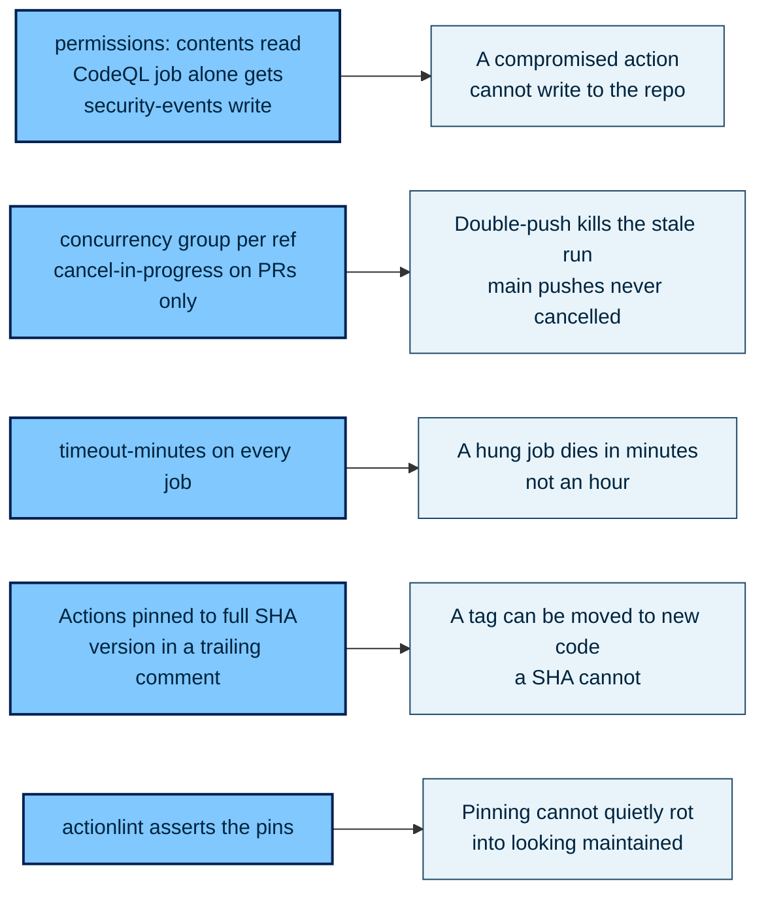

Dependabot's `github-actions` ecosystem keeps those SHA pins current, with
`directories` covering both `/` and `/.github/actions/*`.

---

## When it goes red

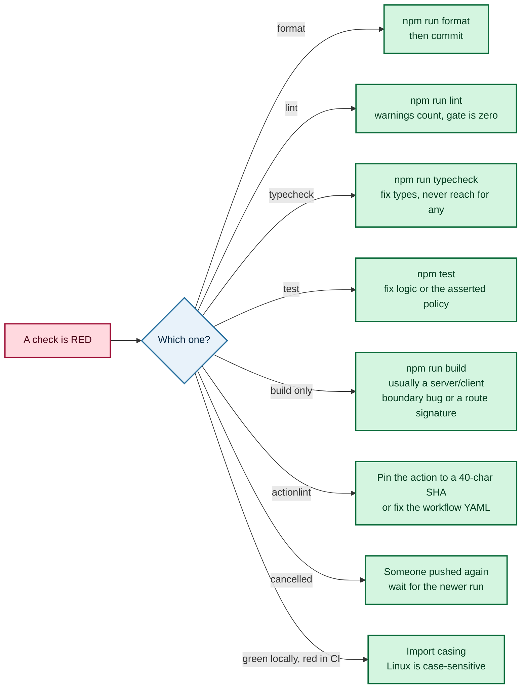

---

## Commands

```bash
npm run format:check   # the format workflow
npm run lint           # the lint workflow
npm run typecheck      # the typecheck workflow
npm test               # the test workflow
npm run build          # the build workflow
```

`--max-warnings=0` lives in `package.json`, not in CI, so local and CI strictness can't
drift. Tests need no secrets: PGlite runs Postgres in-process and loads
`supabase/schema.sql` plus the migrations to exercise real RLS policies.

Run one on GitHub without a new commit: **Actions → workflow → Run workflow**, or
`gh workflow run lint.yml`. The button appears only once the workflow is on `main`.

---

## One-time local config

```bash
git config blame.ignoreRevsFile .git-blame-ignore-revs
```

`format` stays red until one repo-wide `npm run format` commit lands. `.git-blame-ignore-revs`
holds comments only until then — add that commit's SHA to it so `git blame` skips it.

---

## Ubuntu only

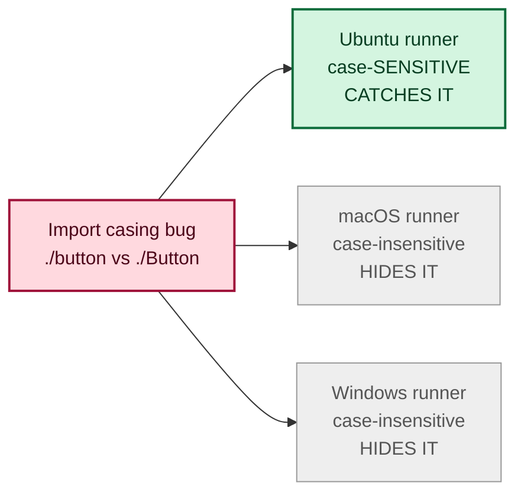

Production is Linux, so Linux is what CI tests. `.nvmrc` plus the lockfile keeps
developer machines consistent, which is what a Node matrix would otherwise be for.

---

## Branch protection

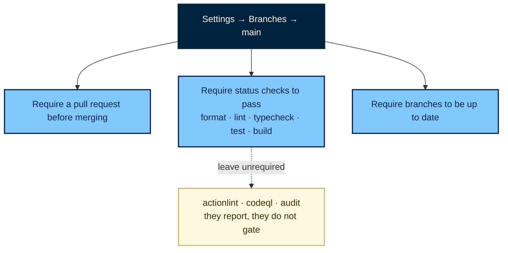

Repo settings, not files, and they need admin. A check is only selectable after it has
reported once. Adding a sixth check later means returning here, which is the cost of
one workflow per check.

---

## Deployment

Not set up. See [`CD_job.md`](./CD_job.md).
