# CI Map

A visual map of continuous integration in this repo. Every diagram renders natively on
GitHub and in the Kiro IDE preview.

**Platform:** GitHub Actions · **Runner:** `ubuntu-latest` · **Node:** pinned in `.nvmrc`
**Required check to merge:** `ci-ok` · **Cost:** free (public repo = unlimited minutes, free CodeQL, free Dependabot)

---

## 1. The whole system

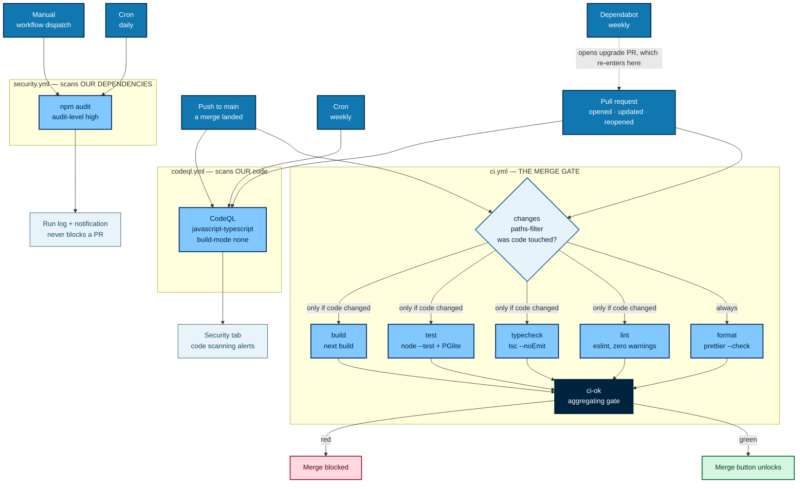

Only `ci.yml` can block a merge. The security workflows report into the Security tab
instead, so a slow scan or a fresh advisory in some transitive package never holds up
unrelated work.

---

## 2. Which check catches which bug

Read right to left: every arrow is a real failure mode and the job that catches it.

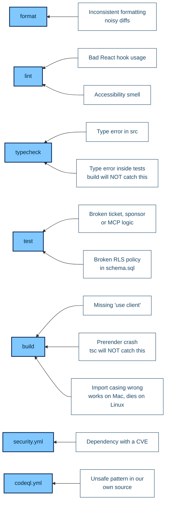

The two "will NOT catch this" labels are why both `typecheck` and `build` exist.
`next.config.ts` sets no `ignoreBuildErrors`, so the build does compile — but it still
won't fail on a type error inside `tests/`, and `tsc` can't detect a prerender crash.

---

## 3. Inside any single job

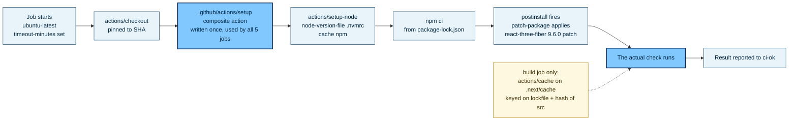

`npm ci` always reinstalls `node_modules` from scratch; the npm cache only skips the
network fetch. That keeps installs reproducible and guarantees `patch-package` runs.

---

## 4. The `ci-ok` gate

This is the one clever piece, so it gets its own diagram.

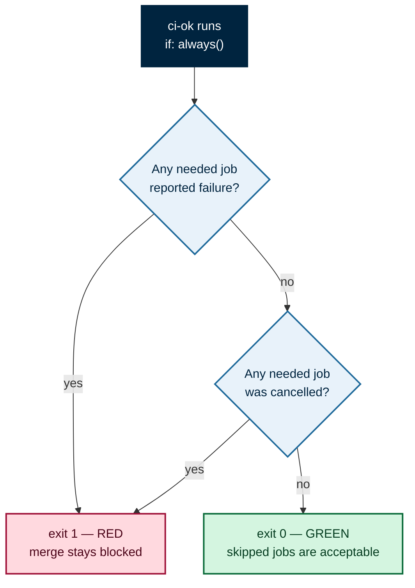

Branch protection requires *named* checks. Require `build` directly and a docs-only PR
that skips `build` waits forever for a check that will never report. One aggregating
job that always runs solves it — and `ci-ok` is then the only check to mark required,
so adding a sixth check later means editing its `needs` list, not GitHub settings.

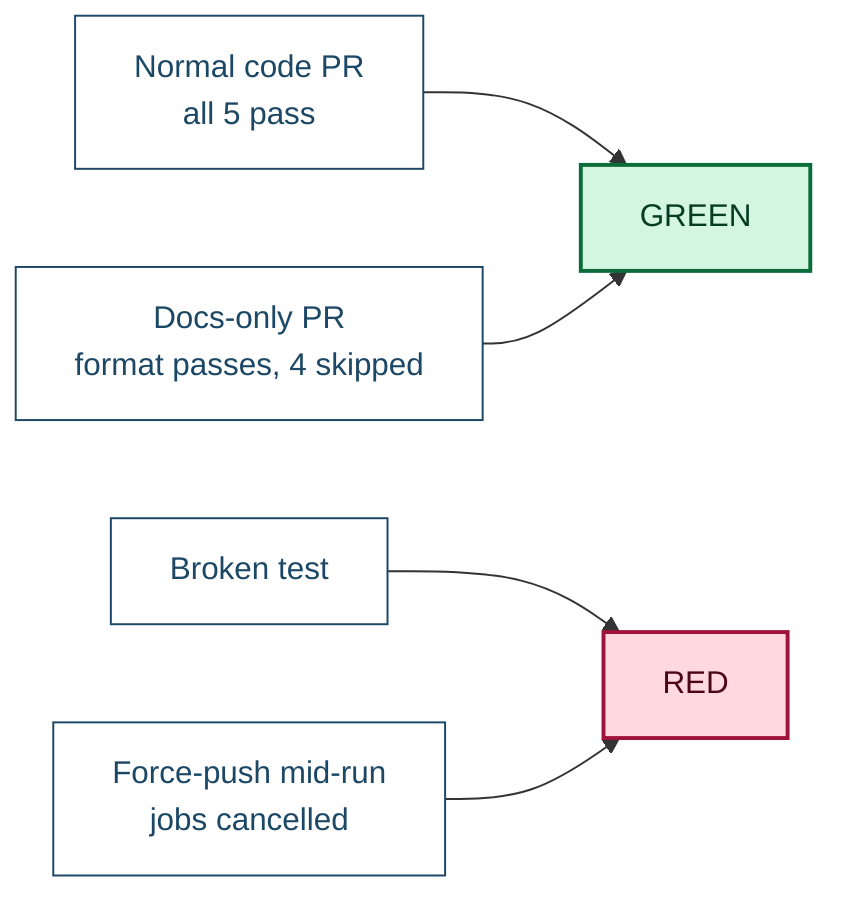

---

## 5. Path filtering

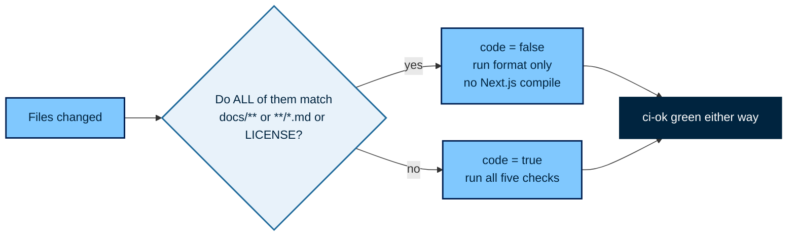

Editing a README shouldn't spend minutes compiling Next.js. `format` stays ungated
because Prettier covers Markdown, so a docs PR still gets a real check rather than a
vacuous green tick.

---

## 6. Security cadence, and why three tools

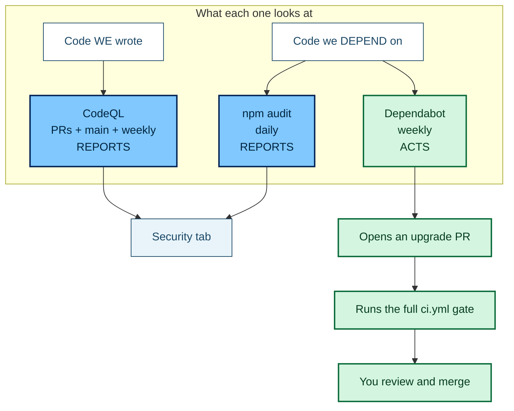

CodeQL is the only one that analyses our own source. `npm audit` only reports.
Dependabot is the only one that *acts* — and its PRs face the same five checks as human
work.

**Why `npm audit` is a cron, not a PR gate:** an advisory on a transitive package with
no fix available would block every unrelated PR in the repo until upstream ships a
patch. On a schedule it informs without holding the team hostage.

**Why there's no nightly re-run of lint/test/build:** `npm ci` installs from a committed
lockfile, so an unchanged `main` yields a byte-identical dependency tree and identical
results. The only inputs that change on their own are the CVE database and CodeQL's
query set — exactly what the two scheduled scans cover.

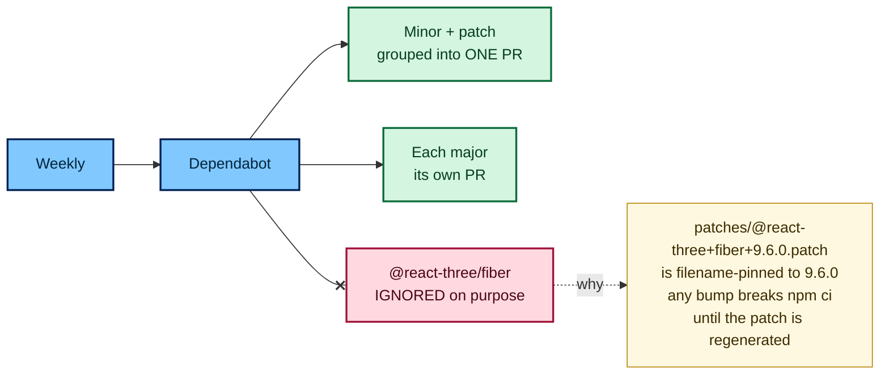

---

## 7. Hygiene applied to every workflow

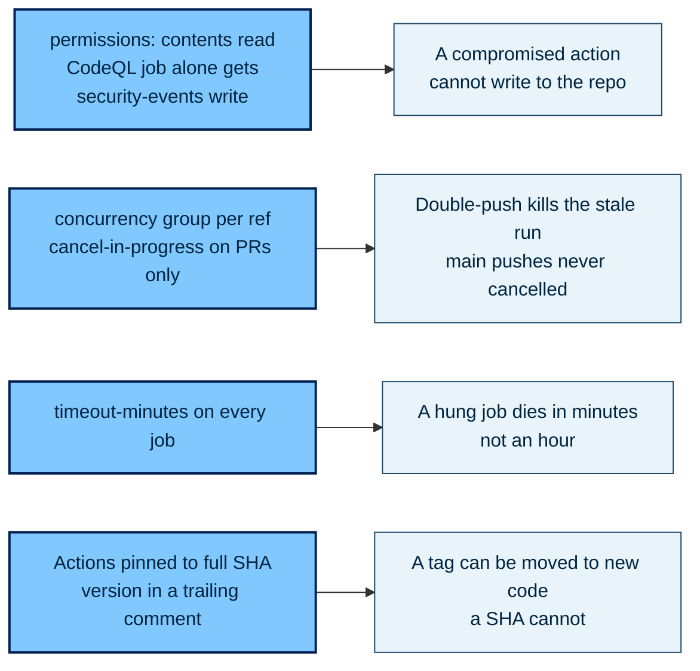

Dependabot's `github-actions` ecosystem is what keeps those SHA pins from going stale.

---

## 8. When it goes red

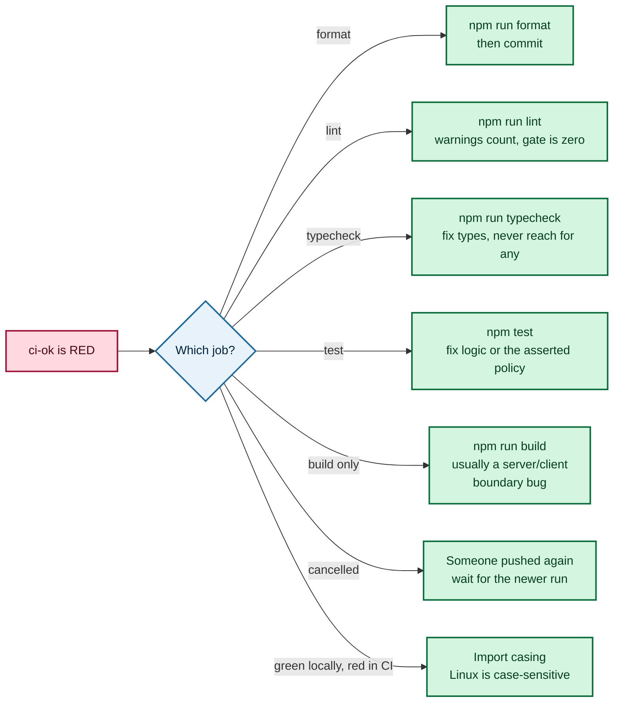

---

## 9. Local commands, mirrored exactly by CI

```bash
npm run format:check   # the format job
npm run lint           # the lint job
npm run typecheck      # the typecheck job
npm test               # the test job
npm run build          # the build job
```

`lint` carries `--max-warnings=0` in `package.json` itself rather than CI passing a
stricter flag, so local strictness and CI strictness cannot drift. All five green on
your machine means CI agrees.

Tests need no secrets: PGlite runs Postgres in-process and loads `supabase/schema.sql`
plus the migrations to exercise real RLS policies. No server, no containers, no
credentials.

---

## 10. One-time local setup

```bash
git config blame.ignoreRevsFile .git-blame-ignore-revs
```

Prettier adoption required one repo-wide reformat commit, which would otherwise make
`git blame` attribute every line to it. `.git-blame-ignore-revs` records that SHA.
GitHub honors the file automatically; locally it takes the config above.

---

## 11. Why Ubuntu only, no OS or Node matrix

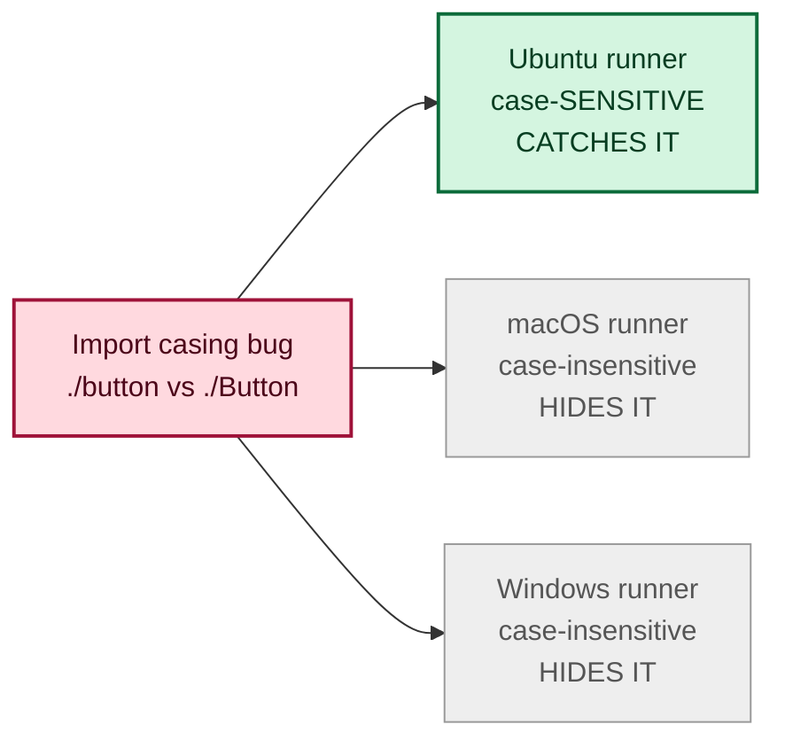

Production runs on Linux regardless of host, so Linux is the only platform that tests
anything a user hits. Adding Mac or Windows runners would be worse than redundant: they
are precisely the environments that hide the main portability bug. Consistency across
developer machines comes from `.nvmrc` plus the committed lockfile, not from runners.

---

## 12. Branch protection — set these in the GitHub UI

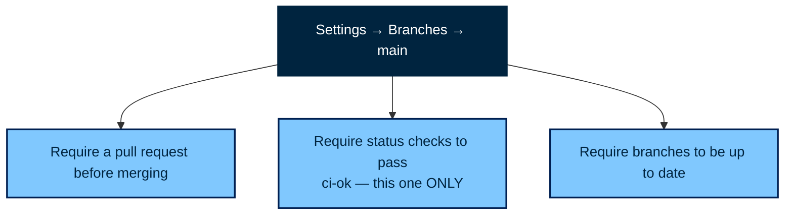

These are repo settings, not files — they have to be clicked.

---

## 13. Not set up yet

Continuous **deployment** is deliberately out of scope. See
[`CD_job.md`](./CD_job.md) for what wiring it up involves, including the rule that any
deploy job must depend on `ci-ok`.
